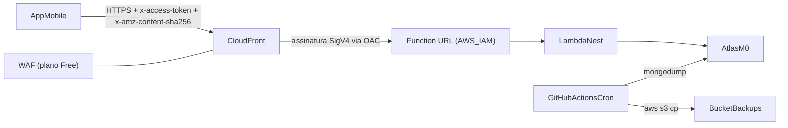

# Backup do Mongo e proteção da API com CloudFront

## Visão geral

Todas as peças usam opções gratuitas: GitHub Actions, S3 (centavos), CloudFront no plano de preço fixo Free (que inclui o WAF e não cobra se passar do limite), Lambda e Atlas M0. O API Gateway HTTP foi descartado porque só é gratuito nos 12 primeiros meses da conta.

## Restrições importantes do OAC com Lambda

- **Header Authorization:** o CloudFront usa o `Authorization` para a assinatura SigV4, então o JWT não pode mais ir nesse header. O token passa para um header próprio, `x-access-token`.
- **Hash do corpo:** em POST, PUT e PATCH, o cliente precisa enviar `x-amz-content-sha256` com o SHA-256 (em hexadecimal) do corpo exato da requisição.
- **Swagger:** o "Try it out" de rotas com corpo deixa de funcionar pelo CloudFront. Ele continua funcionando localmente.

## Parte 1: Backup do Mongo

- **Bucket no [time-tracker/serverless.yml](time-tracker/serverless.yml), em `resources`:** `AWS::S3::Bucket` chamado `time-tracker-mongo-backups-556479867163`, com `PublicAccessBlockConfiguration` bloqueando todo acesso público, uma regra de ciclo de vida que expira os arquivos após 90 dias e `DeletionPolicy: Retain`.
- **IAM (passo manual no console):** criar um usuário `time-tracker-backup` com uma política que permite somente `s3:PutObject` em `arn:aws:s3:::time-tracker-mongo-backups-556479867163/`*. As chaves dele vão para os secrets `BACKUP_AWS_ACCESS_KEY` e `BACKUP_AWS_SECRET_ACCESS_KEY` no GitHub.
- **Workflow novo em [time-tracker/.github/workflows/backup-mongo.yml](time-tracker/.github/workflows/backup-mongo.yml):**
  - Disparo por `schedule` (domingo, 06:00 UTC) e por `workflow_dispatch`.
  - Instala o pacote `.deb` do MongoDB Database Tools para ubuntu2404.
  - Roda `mongodump --uri="$MONGO_URL" --archive=backup-<data>.gz --gzip`.
  - Envia o arquivo com `aws s3 cp` usando os secrets de backup.
- **[time-tracker/.gitignore](time-tracker/.gitignore):** adicionar `dump/` e `backup-*.gz`.

## Parte 2: CloudFront com OAC no `serverless.yml`

- **Runtime:** trocar `runtime: nodejs18.x` por `nodejs22.x`. No [pipeline-merge-main.yml](time-tracker/.github/workflows/pipeline-merge-main.yml), usar `node-version: '22'`.
- **Retenção de logs:** `logRetentionInDays: 14` no `provider`.
- **Function URL:** trocar `url: true` por `url: { authorizer: aws_iam }`. Isso entra só na etapa final do rollout, descrita mais abaixo.
- **Recursos novos em `resources`:**
  - `AWS::CloudFront::OriginAccessControl` com `OriginAccessControlOriginType: lambda`, `SigningBehavior: always` e `SigningProtocol: sigv4`.
  - `AWS::CloudFront::Distribution`:
    - Origem: o domínio extraído de `ApiLambdaFunctionUrl.FunctionUrl` com `Fn::Select` e `Fn::Split`.
    - Comportamento: `AllowedMethods` com todos os métodos e `ViewerProtocolPolicy: https-only`.
    - Política de cache gerenciada `CachingDisabled` (`4135ea2d-6df8-44a3-9df3-4b5a84be39ad`).
    - Política de requisição para a origem `AllViewerExceptHostHeader` (`b689b0a8-53d0-40ab-baf2-68738e2966ac`), que repassa headers, query string e cookies, exceto o Host.
  - Duas `AWS::Lambda::Permission` com principal `cloudfront.amazonaws.com` e `SourceArn` igual ao ARN da distribuição:
    - uma para `lambda:InvokeFunctionUrl` (com `FunctionUrlAuthType: AWS_IAM`);
    - outra para `lambda:InvokeFunction`, que as Function URLs criadas recentemente também exigem.
  - Um `Outputs` com o domínio da distribuição (`xxxx.cloudfront.net`).
- **Concorrência reservada (opcional):** `reservedConcurrency: 5` na função, como teto de custo. Só aplicar se a cota de concorrência da conta permitir.

## Parte 3: WAF pelo plano gratuito (passo manual no console)

- **Plano:** no console do CloudFront, associar a distribuição ao plano de preço fixo Free. Antes, conferir os limites atuais (requisições e transferência por mês).
- **Regra de limite por IP:** no Web ACL incluído no plano, ativar uma regra por IP (por exemplo, 300 requisições a cada 5 minutos) e manter as regras gerenciadas padrão.
- **Alerta de custo:** criar um alerta de US$ 1 no AWS Budgets.

## Parte 4: Backend lê o JWT de `x-access-token`

- **[time-tracker/src/modules/auth/jwt.strategy.ts](time-tracker/src/modules/auth/jwt.strategy.ts):** usar `ExtractJwt.fromExtractors([ExtractJwt.fromHeader('x-access-token'), ExtractJwt.fromAuthHeaderAsBearerToken()])`. Isso mantém o `Authorization` funcionando no desenvolvimento local.
- **[time-tracker/src/modules/auth/jwt-auth.guard.ts](time-tracker/src/modules/auth/jwt-auth.guard.ts):** ler `request.headers['x-access-token']` primeiro e só usar `authorization` como alternativa.
- **[time-tracker/src/config/swagger/init.ts](time-tracker/src/config/swagger/init.ts):** declarar a autenticação como `apiKey` no header `x-access-token`.
- **Secret `LAMBDA_URL` no GitHub:** atualizar para o domínio do CloudFront.

## Parte 5: App mobile

- **Dependência:** adicionar `expo-crypto`.
- **[time-tracker-mobile/src/infra/api/api.ts](time-tracker-mobile/src/infra/api/api.ts):** no interceptor de requisição:
  - Enviar o token em `config.headers['x-access-token']` no lugar de `Authorization`.
  - Quando houver corpo (`config.data`), serializar com `JSON.stringify` no próprio interceptor e definir `Content-Type: application/json`.
  - Calcular o hash com `Crypto.digestStringAsync(SHA256, body)` e enviá-lo em `x-amz-content-sha256`.
- **[time-tracker-mobile/src/infra/repositories/reports.repository.ts](time-tracker-mobile/src/infra/repositories/reports.repository.ts):** trocar o header do download para `x-access-token`. É um GET sem corpo, então não precisa de hash.
- **[time-tracker-mobile/eas.json](time-tracker-mobile/eas.json):** `EXPO_PUBLIC_API_URL` passa a ser o domínio do CloudFront. Como a variável é embutida na compilação, é preciso gerar um build novo.

## Ordem de rollout

O app instalado hoje chama a Function URL diretamente, então a troca para IAM tem que ser a última etapa:

1. Fazer o deploy do backend com o bucket, o CloudFront, o OAC e o suporte ao `x-access-token`, ainda com `url: true`.
2. Associar o plano Free e o WAF, e testar com `curl` pelo domínio do CloudFront.
3. Gerar e instalar o build novo do app, apontando para o CloudFront, nos 2 aparelhos.
4. Trocar para `url: { authorizer: aws_iam }` e fazer o deploy. Conferir que a Function URL direta passa a responder 403 e que o CloudFront continua funcionando.
5. Rodar o workflow de backup manualmente uma vez e verificar se o arquivo apareceu no S3.

